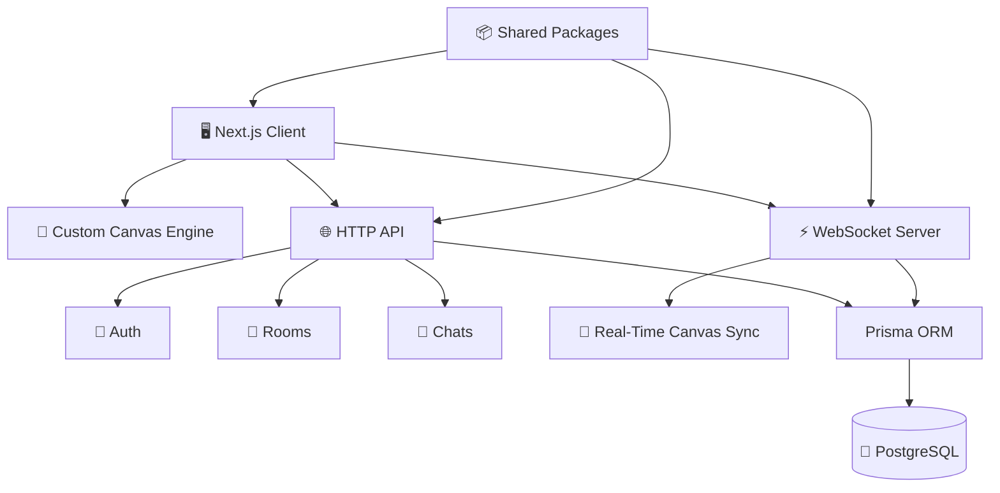

# 🎨 Excali-Plus

> **A real-time collaborative whiteboard built from scratch with a custom canvas engine, WebSockets, and a scalable TypeScript monorepo.**

Excali-Plus is a real-time collaborative whiteboard application designed to make drawing, diagramming, and collaboration seamless.

It combines a **custom canvas rendering engine**, **real-time WebSocket synchronization**, **room-based collaboration**, and **secure authentication** — all organized inside a scalable **Turborepo monorepo**.

---

##  Features

| Feature                       | Description                                                                                        |
| ----------------------------- | -------------------------------------------------------------------------------------------------- |
|  **Real-Time Collaboration** | Synchronize canvas changes across multiple clients using a dedicated WebSocket backend.            |
|  **Custom Canvas Engine**   | Hand-built rendering system with hit testing, resizing, viewport management, and canvas utilities. |
|  **Shape & Tool System**    | Extensible element factory and tool state management for different drawing operations.             |
|  **Room-Based Sessions**    | Create, join, and share isolated collaborative canvas rooms.                                       |
|  **Authentication**         | Traditional sign-up/sign-in flows with Google Login support.                                       |
| ↩ **Undo / Redo**            | History middleware tracks canvas state changes for reliable undo and redo operations.              |
|  **Canvas Export**         | Export your drawings and diagrams as images.                                                       |
|  **Monorepo Architecture**  | Shared packages and independently deployable applications managed with Turborepo and pnpm.         |

---

##  Architecture

Excali-Plus follows a layered architecture where the frontend, HTTP API, real-time communication, and database are separated into independently maintainable services.



##  Tech Stack

### Frontend

* **Next.js** — App Router
* **React**
* **TypeScript**
* **Redux** — Canvas, history, tools, UI, and user state
* **Tailwind CSS**
* Custom Canvas Rendering Engine

### Backend

* **Node.js**
* **Express.js** — REST API
* **WebSocket** — Real-time collaboration
* **Prisma ORM**
* **PostgreSQL**

### Infrastructure & Tooling

* **Turborepo** — Monorepo orchestration
* **pnpm** — Workspace and package management
* **Docker**
* **Docker Compose**

---

##  Project Structure

```text
excali-plus/
│
├── apps/
│   │
│   ├── excali-plus/                  # Next.js frontend
│   │   ├── app/
│   │   │   ├── auth/
│   │   │   ├── canvas/
│   │   │   │   └── [roomId]/
│   │   │   └── ...
│   │   │
│   │   ├── components/
│   │   │   ├── Canvas.tsx
│   │   │   ├── AuthBox.tsx
│   │   │   ├── ToolOptionsPanel.tsx
│   │   │   └── ZoomControls.tsx
│   │   │
│   │   ├── store/
│   │   │   ├── canvas/
│   │   │   ├── history/
│   │   │   ├── tools/
│   │   │   ├── ui/
│   │   │   └── user/
│   │   │
│   │   └── utils/
│   │       ├── renderCanvas.ts
│   │       ├── hitTest.ts
│   │       └── elementFactory.ts
│   │
│   ├── http-backend/                  # REST API
│   │   └── src/
│   │       ├── controllers/
│   │       ├── routes/
│   │       └── middlewares/
│   │
│   └── ws-backend/                    # Real-time WebSocket server
│
├── packages/
│   │
│   ├── db/                            # Prisma + PostgreSQL
│   │   ├── schema.prisma
│   │   └── migrations/
│   │
│   ├── ui/                            # Shared UI components
│   │   ├── button.tsx
│   │   ├── card.tsx
│   │   └── input.tsx
│   │
│   ├── common/                        # Shared types & utilities
│   ├── backend-common/                # Shared backend utilities
│   ├── eslint-config/                 # Shared ESLint configuration
│   └── typescript-config/             # Shared TypeScript configuration
│
├── package.json
├── pnpm-workspace.yaml
└── turbo.json
```

---

##  Getting Started

### Prerequisites

Make sure you have the following installed:

* [Node.js](https://nodejs.org/)
* [pnpm](https://pnpm.io/)
* [Docker](https://www.docker.com/)
* Docker Compose

---

### 1. Clone the Repository

```bash
git clone <repository-url>

cd excali-plus
```

### 2. Install Dependencies

Install all workspace dependencies using pnpm:

```bash
pnpm install
```

---

### 3. Configure Environment Variables

Create the required `.env` files using the provided `.env.example` files.

Environment configuration is required for:

```text
apps/http-backend/
apps/ws-backend/
```

Make sure the required database, authentication, and service configuration values are populated before starting the application.

---

### 4. Start PostgreSQL

The database is configured through Docker Compose.

```bash
cd packages/db

docker-compose up -d
```

---

### 5. Run Prisma Migrations

Initialize the database schema:

```bash
pnpm dlx prisma migrate dev
```

---

### 6. Start the Development Environment

From the repository root:

```bash
pnpm run dev
```

This starts the Turborepo development environment and runs the required applications together.

---

##  Custom Canvas Engine

One of the core parts of Excali-Plus is its custom canvas rendering engine.

Instead of relying entirely on a third-party whiteboard implementation, the project handles important canvas operations internally.

### Core Responsibilities

```text
User Interaction
       │
       ▼
┌─────────────────┐
│ Tool Management │
└────────┬────────┘
         ▼
┌─────────────────┐
│ Element Factory │
└────────┬────────┘
         ▼
┌─────────────────┐
│ Canvas State    │
└────────┬────────┘
         ▼
┌─────────────────┐
│ Canvas Renderer │
└────────┬────────┘
         ▼
┌─────────────────┐
│ Hit Testing /   │
│ Viewport Logic  │
└─────────────────┘
```

Key utilities include:

* `renderCanvas.ts` — Canvas rendering logic
* `hitTest.ts` — Detect interaction with canvas elements
* `elementFactory.ts` — Create and manage drawable elements

---

##  Real-Time Collaboration

Excali-Plus uses a dedicated WebSocket backend for low-latency synchronization between clients.

```text
       Client A                         Client B
          │                               │
          │       Canvas Update           │
          ├──────────────┐                │
          │              ▼                │
          │       WebSocket Server        │
          │              │                │
          │       Broadcast Update        │
          │              ├────────────────►
          │                               │
          ▼                               ▼
     Updated Canvas                  Updated Canvas
```

This separation allows real-time canvas communication to remain independent from the traditional HTTP API.

---

##  State Management

The frontend uses Redux to keep different application concerns isolated.

```text
Redux Store
│
├── canvas    → Canvas elements & drawing state
├── history   → Undo / Redo state
├── tools     → Active drawing tools
├── ui        → UI state
└── user      → Authentication / user state
```

This structure keeps canvas interactions predictable while allowing history and UI state to evolve independently.

---

##  Monorepo

The project uses **Turborepo + pnpm workspaces** to manage applications and shared packages from a single repository.

This provides:

* Shared TypeScript configuration
* Reusable UI components
* Shared types
* Centralized database package
* Independent backend services
* Consistent development tooling
* Scalable workspace management

```text
                    Excali-Plus
                        │
             ┌──────────┴──────────┐
             │                     │
           Apps                 Packages
             │                     │
     ┌───────┼───────┐      ┌──────┼─────────┐
     │       │       │      │      │         │
   Next.js  HTTP     WS     DB     UI     Common
```

---

## 🐳 Docker

Docker is used to simplify local infrastructure and database setup.

Start the database with:

```bash
cd packages/db
docker-compose up -d
```

Stop running containers with:

```bash
docker-compose down
```

---


## 🤝 Contributing

Contributions, ideas, and feedback are welcome.

A typical development workflow:

```bash
# Install dependencies
pnpm install

# Start infrastructure
cd packages/db
docker-compose up -d

# Run migrations
pnpm dlx prisma migrate dev

# Start development
cd ../..
pnpm run dev
```

Before submitting a change, make sure the affected application/package builds and the existing functionality continues to work as expected.

---


<div align="center">

### Built with TypeScript, WebSockets & a lot of canvas math. 🎨

**Excali-Plus** — Draw. Collaborate. Create.

</div>
